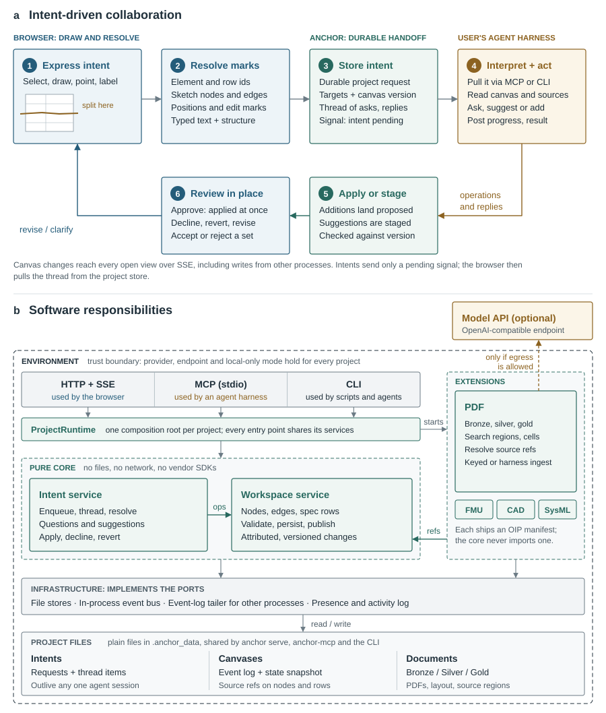

# Anchor architecture: a brief for drawing diagrams

This page describes Anchor's architecture as parts and connections, so a
diagram can be drawn from it without reading the code. Each part has a short
id in `code`. Use the ids to keep labels consistent across diagrams.

The prose explanation lives in [Architecture](../concepts/architecture.md).
This page is the inventory behind it.

## What Anchor is, in three sentences

Anchor is a shared workspace where people and agents work on the same canvas.
Documents (PDFs, FMUs, CAD, SysML) are turned into source regions with exact
page and box positions, and every value placed on the canvas points back to
its source. People use a web app, agents use MCP or the CLI, and all of them
reach the same services, stores and live event stream.

## Actors

| Id | Actor | Talks to Anchor through |
|---|---|---|
| `human` | A person in the browser | `web` over HTTP and SSE |
| `agent` | An agent harness (Claude Code, Claude Desktop, Cursor) | `mcp` (stdio) or `cli` |
| `shell` | A person or script in a terminal | `cli` |
| `model_api` | An OpenAI-compatible endpoint (OpenAI, Azure, Ollama, custom) | Called by `pdf_ext` for page polish, region extraction and remote embeddings |

## Parts

### Front end

| Id | Part | Notes |
|---|---|---|
| `web` | Web app | React 19, Vite, Tailwind, React Flow (`@xyflow/react`), Zustand, TanStack Query, pdf.js, three.js. Built into `web/dist/` and served by `http`, same origin. |
| `web_canvas` | Canvas view | Nodes and edges. Shapes: note, text, fact, concept, entity, area, funnel, markdown. Primitives: document, image, table, chart, 3D model, sub-canvas, SysML block, requirement, package. |
| `web_viewer` | Source viewer | Shows a PDF page with its regions. A region dragged to the canvas becomes a spec card, or an image node for a picture region. |
| `web_shell` | App shell panels | Files explorer, canvases, intents, proposals, properties, catch-up, ingest activity. |
| `web_live` | Live client | SSE subscriptions for canvas events, intents and ingests. |

### Adapters (transport)

| Id | Part | Notes |
|---|---|---|
| `http` | HTTP server | FastAPI. Routers: workspaces, nodes, edges, projects, intents, ingests, status, SSE. The PDF extension adds documents, upload and ingest-session routes. Started by `anchor serve`. |
| `sse` | SSE stream | Per-workspace event stream at `/api/workspaces/{slug}/events`. |
| `mcp` | MCP server | `anchor-mcp`, stdio. Canvas tools, extension tools, intent tools. A small core set is advertised by default; the long tail stays callable (tiering). |
| `cli` | CLI | `anchor`, Typer. Init, env, project, ingest, search, embed, canvas, serve, check, models, intents. |
| `runtime` | ProjectRuntime | Composition root for one project. Every adapter asks it for services, so all adapters share the same stores and bus. Named profiles (`canvas`, `ingest`, `extensions`, `full`) load only what a command needs. |
| `ext_host` | Extension host | Discovers bundled extensions and their OIP manifests. |

### Core (pure domain, no I/O)

| Id | Part | Notes |
|---|---|---|
| `ws_service` | WorkspaceService | The only writer of canvas state. Validates a command, applies the reducer, persists, publishes an event. Also proposals, references, batch operations and layout. |
| `intent_service` | IntentService | The agent request queue. A person raises an intent (an ask, a thread) on a canvas; the agent pulls it, works, and resolves it. Publishes a small `IntentPending` signal on the bus. |
| `domain` | Workspace model | Workspace, nodes, edges, reducer, evidence (claim bindings), references, proposal sets, review states, node-type schemas. |
| `events` | DomainEvent | Every mutation is one event, stamped with an actor: human, agent or system. |
| `ports` | Ports | Protocols for the workspace store, intent store, event bus, snapshotter and workspace locks. |

### Infra (concrete I/O behind the ports)

| Id | Part | Notes |
|---|---|---|
| `bus` | Event bus | In-process publish and subscribe. |
| `tailer` | Event tailer | Watches `events.jsonl` and republishes events written by another process (an MCP or CLI process) onto the server's bus. |
| `ws_store` | Workspace store | Files: `events.jsonl` (append-only log), `state.json` (snapshot), `meta.json`. Cold start replays events newer than the snapshot. |
| `intent_store` | Intent store | Files in the project's `intents/` directory. |
| `config` | Config and environments | Resolves environment and project settings (`env.toml`, `anchor.toml`). |
| `egress` | Egress policy | Decides which model clients may exist for the environment. |
| `presence` | Presence | Who is on a canvas now: SSE connections and recent writers. |
| `activity` | Activity log | One line per HTTP request or MCP tool call in `activity.jsonl`. |
| `serve_registry` | Serve registry | Records which `anchor serve` runs on which port for which project. |
| `snapshotter` | Snapshotter | Headless Chromium renders a canvas to an image. The only place Playwright is imported. |

### Extensions (producers)

Each extension repeats the same layering inside itself (core, infra,
adapters) and ships an OIP manifest. The canvas core never imports an
extension.

| Id | Extension | What it produces |
|---|---|---|
| `pdf_ext` | `anchor_pdfs` | PDF ingest into bronze, silver and gold layers; region search; source resolution; synopsis. The largest extension. |
| `fmu_ext` | `anchor_fmus` | FMU upload, inspection and simulation. |
| `cad_ext` | `anchor_cad` | CAD models (STL, STEP, glTF, OpenSCAD) as canvas nodes. Early scaffold. |
| `sysml_ext` | `anchor_sysml` | SysML v2 text into block, requirement and package nodes with edges. |

### Inside the PDF extension

| Id | Part | Notes |
|---|---|---|
| `ingest_service` | IngestService | Runs the keyed pipeline: bronze, silver, gold, embeddings. |
| `session_service` | IngestSessionService | Harness-driven ingest. The agent itself reads page work items and submits regions (`ingest_begin`, `ingest_submit_page`, `ingest_finalize`). No API key needed. |
| `docling` | PDF extractor | Docling layout and OCR. Items with labels (text, table, picture, section header) and boxes in PDF points. |
| `renderer` | Page renderer | PyMuPDF renders page images and crops. |
| `polisher` | Markdown polisher | Vision model cleans each page's markdown. |
| `region_extractor` | Region extractor | Vision model groups Docling items into regions (table, spec block, figure, diagram, chart, text) with title and description. |
| `region_resolution` | Region resolution | Geometry guards: snaps regions to Docling items, keeps one table per block, gives a picture region its picture's frame. |
| `embedder` | Embedder | Local ONNX model on the host (default `BAAI/bge-small-en-v1.5`), or a remote `text-embedding-*` model. Embeds each region's title, description and content. |
| `search` | Search | Embeds the query with the same model and ranks regions. Skips documents embedded with another model. |
| `doc_store` | Document store | Files under `bronze/`, `silver/`, `gold/`. |

## Storage on disk

```
~/.anchor/
  envs/<environment>/
    env.toml                  provider, endpoint, models, local_only
    projects/<project>/
      anchor.toml             project overrides
      .anchor_data/
        bronze/<doc>/         original PDF, identity
        silver/<doc>/         Docling view: page markdown, item metadata
        gold/<doc>/           regions per page, embeddings.json, .complete.json
        canvases/<canvas>/    events.jsonl, state.json, meta.json
        intents/              the agent request queue
        activity.jsonl        one line per adapter call
  serves/                     which serve runs where
```

Everything is plain files. There is no database, no queue and no external
service. Draw it as one filesystem with folders, not as separate databases.

## Boundaries worth drawing

1. **Layer boundary (the hexagon).** `adapters` → `infra` → `core`, one
   direction only. `core` imports no web framework, no SDK, no file I/O.
   Extensions sit beside the hexagon and plug in at the adapter seam. CI
   enforces this with import-linter.
2. **Environment trust boundary.** An environment owns model egress: its
   provider, endpoint and local-only flag apply to every project inside it.
   Providers: `openai`, `azure`, `custom`, `ollama` (endpoint), `local` (no
   egress), `harness` (no Anchor-side model; the agent reads pages itself).
   Draw `model_api` outside this boundary, reachable only when `egress`
   allows it.
3. **Process boundary.** `anchor serve` (HTTP), `anchor-mcp` (one per agent
   connection) and `anchor` CLI calls are separate processes on one data
   directory. They meet in the files; `tailer` carries events between them.

## Connections

Use these as labelled edges.

| From | To | Label |
|---|---|---|
| `human` | `web` | uses |
| `web` | `http` | REST calls |
| `sse` | `web_live` | live events |
| `agent` | `mcp` | MCP tool calls (stdio) |
| `agent` | `cli` | shell commands |
| `shell` | `cli` | shell commands |
| `http`, `mcp`, `cli` | `runtime` | get shared services |
| `runtime` | `ws_service`, `intent_service`, `ingest_service`, `session_service` | wires |
| `runtime` | `ext_host` | starts extensions |
| `ws_service` | `ws_store` | append event, save snapshot |
| `ws_service` | `bus` | publish event |
| `intent_service` | `intent_store` | read, write intents |
| `intent_service` | `bus` | publish `IntentPending` |
| `bus` | `sse` | fan out to subscribers |
| `tailer` | `bus` | republish events from other processes |
| `ws_store` | `tailer` | `events.jsonl` |
| `ingest_service` | `docling` | extract layout |
| `ingest_service` | `polisher`, `region_extractor` | vision calls |
| `polisher`, `region_extractor` | `model_api` | HTTPS, if egress allows |
| `ingest_service` | `region_resolution` | ground regions |
| `ingest_service` | `embedder` | embed regions |
| `ingest_service` | `doc_store` | write bronze, silver, gold |
| `ingest_service` | `bus` | ingest progress |
| `session_service` | `agent` | page work items out, regions back |
| `search` | `embedder` | embed query |
| `search` | `doc_store` | read vectors and regions |
| `web_viewer` | `web_canvas` | drag region onto canvas |
| `web_canvas` node | `doc_store` region | `source_ref`: slug, page, bbox |

## Flows worth showing step by step

### 1. Ingest a PDF (keyed)

1. `cli` or `mcp` calls `ingest_service` with a PDF.
2. Bronze: the original is stored with a content hash.
3. Silver: `docling` extracts items and boxes per page; `renderer` makes page images.
4. Gold: `polisher` cleans page markdown; `region_extractor` proposes regions; `region_resolution` snaps them to Docling items and computes each region's `content`.
5. `embedder` embeds each region; vectors go to `gold/<doc>/embeddings.json`.
6. A `.complete.json` marker makes the document visible to search.

### 2. Ingest a PDF (harness)

Same as flow 1, except the model calls in step 4 are replaced by the agent:
`session_service` hands the agent one page at a time, the agent submits regions,
`region_resolution` validates them, and finalize writes gold and embeddings.

### 3. A value lands on the canvas, grounded

1. The agent searches (`search`) or reads gold regions.
2. It adds a node through `mcp` → `ws_service` with a `source_ref` (slug, page, bbox).
3. `ws_service` appends the event, saves the snapshot and publishes.
4. `bus` → `sse` → `web_live`: the node appears in every open browser within about 50 ms.
5. The person hovers the value and sees the source box on the page.

### 4. A person asks, the agent acts

1. The person raises an intent on a canvas (`web` → `http` → `intent_service`).
2. `intent_service` stores it and publishes `IntentPending`.
3. The agent, listening, pulls the intent (`mcp`), works on the canvas, and resolves it.
4. Agent additions can arrive as a proposal set the person accepts or rejects as one.

## Suggested diagrams

1. **System context.** Actors, the four entry points (web, HTTP, MCP, CLI),
   Anchor as one box, the filesystem, and `model_api` outside the
   environment boundary.
2. **The hexagon.** Core in the middle, infra around it, adapters on the
   outside, extensions plugged in at the side. Arrows only inward.
3. **PDF pipeline.** Bronze, silver, gold as three stages left to right,
   with Docling, the vision model (or the agent, in harness mode), and the
   embedder feeding them.
4. **Live sync.** Three processes (serve, MCP, CLI) writing to one
   `events.jsonl`; the tailer and bus carrying events to SSE and the browser.
5. **Intent loop.** Person → intent → agent → canvas → person, as a cycle.
6. **Environments and projects.** Nested boxes: environment (trust and
   egress) contains projects (documents and canvases).

## Drawing notes

- One process box per running thing; files as a folder shape.
- Show extensions as plug-ins on the side of the hexagon, not inside the core.
- Keep the same id-to-label mapping across all diagrams.
- Monochrome fits the existing diagrams in `docs/assets/diagrams/`.

## The generated figure

`build_diagram.py` in this folder draws suggested diagrams 2 and 5 as one
figure: the intent loop (panel a) and the software layers inside one
environment (panel b).



Rebuild it from the repository root after changing the script:

```bash
uv run docs/architecture/build_diagram.py --png /tmp/anchor-architecture.png
```

It writes `docs/assets/diagrams/anchor-architecture.svg` and `.pdf` (190 mm
wide). The script declares its own dependencies, so `uv run` needs nothing
installed in the project. The build fails when a label overflows its box,
crosses a border or collides with another label; it measures the rendered
text in headless Chromium. Work Sans ships in `fonts/` under the SIL Open
Font License.
